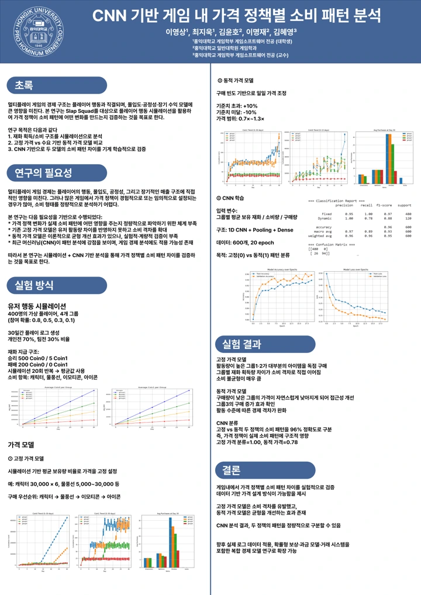

# CISC-W 2025, Game Pricing and Consumption Patterns

  

**筆頭著者、ポスター発表**

[2025年 韓国情報保護学会 冬季学術大会](https://kiisc.or.kr/payment/pay/292)

2025.11.27 ~ 28, Konjiam Resort, Gwangju, Korea

## CNNを用いたゲーム内価格政策別の消費パターン分析

Slap Squadのアイテム価格を検討する過程から生まれた研究です。仮想プレイヤー400人の30日間の消費を20回繰り返し、固定価格と需要に応じた価格を比較しました。CNNによるシミュレーション消費パターンの分類精度は96%でした。

[論文 (PDF)](paper/cisc-w-2025-paper.pdf), [学会発表ポスター (PDF)](paper/cisc-w-2025-poster.pdf), [Portfolio](https://ysl-ryudo.github.io/ja/research/cisc/)

## 共著者

Young-Sang Lee, Ji-Uk Choi, Yun-Ho Kim, Myeong-Jae Lee, Hye-Young Kim

[Slap Squad, Unity](https://github.com/YSL-RyuDo/BNB), [Slap Squad, C++ server](https://github.com/YSL-RyuDo/BnBServer)
