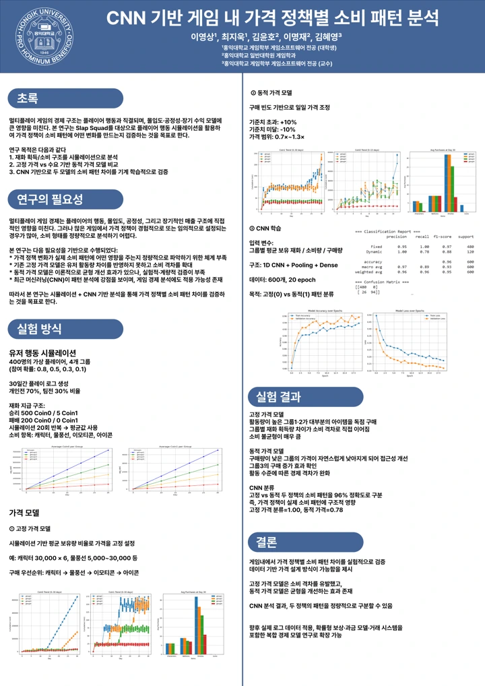

# CISC W 2025, Game Pricing and Consumption Patterns

  

**제1저자, 포스터 발표**

[2025 한국정보보호학회 동계학술대회](https://kiisc.or.kr/payment/pay/292)

2025.11.27 ~ 28, Konjiam Resort, Gwangju, Korea

## CNN 기반 게임 내 가격정책별 소비패턴 분석

Slap Squad의 아이템 가격을 정하는 고민에서 시작한 연구입니다. 가상 플레이어 400명의 30일 소비를 20회 반복해 고정 가격과 수요 기반 가격을 비교했습니다. CNN의 시뮬레이션 소비 패턴 분류 정확도는 96%였습니다.

[논문 (PDF)](paper/cisc-w-2025-paper.pdf), [학회 발표 포스터 (PDF)](paper/cisc-w-2025-poster.pdf), [Portfolio](https://ysl-ryudo.github.io/ko/research/cisc/)

## 공동저자

Young-Sang Lee, Ji-Uk Choi, Yun-Ho Kim, Myeong-Jae Lee, Hye-Young Kim

[Slap Squad, Unity](https://github.com/YSL-RyuDo/SlapSquad), [Slap Squad, C++ server](https://github.com/YSL-RyuDo/SlapSquadServer)
