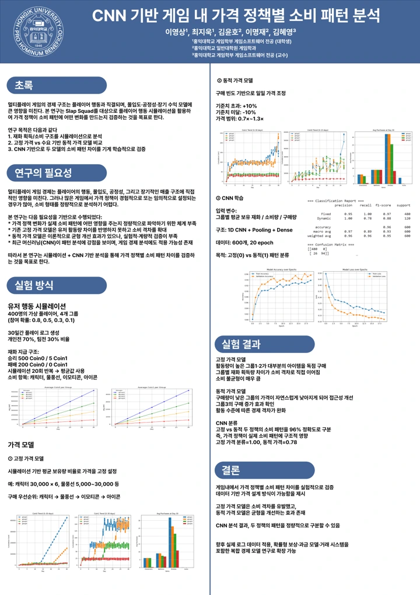

# CISC W 2025, Game Pricing and Consumption Patterns

  

**First author, poster presenter**

[2025 Winter Conference of the Korea Institute of Information Security and Cryptology](https://kiisc.or.kr/payment/pay/292)

2025.11.27 ~ 28, Konjiam Resort, Gwangju, Korea

## Consumption Pattern Analysis of In-Game Pricing Policies Using Convolutional Neural Networks

This study grew out of item-pricing decisions in Slap Squad. It compares fixed and demand-adjusted prices using 400 simulated players over 30 days, repeated 20 times. A CNN classified the simulated consumption patterns with a reported accuracy of 96%.

[Paper (PDF)](paper/cisc-w-2025-paper.pdf), [Conference poster (PDF)](paper/cisc-w-2025-poster.pdf), [Portfolio](https://ysl-ryudo.github.io/en/research/cisc/)

## Authors

Young-Sang Lee, Ji-Uk Choi, Yun-Ho Kim, Myeong-Jae Lee, Hye-Young Kim

[Slap Squad, Unity](https://github.com/YSL-RyuDo/SlapSquad), [Slap Squad, C++ server](https://github.com/YSL-RyuDo/SlapSquadServer)
